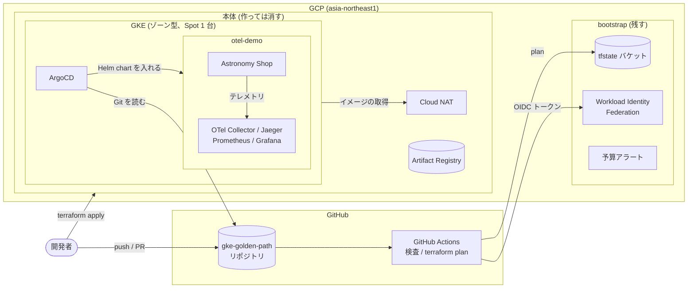

# gke-golden-path

GKE の上に、開発者が使う「ゴールデンパス」を備えた、小さな内部開発者プラットフォームを作る学習プロジェクト。
題材のアプリは [OpenTelemetry Demo (Astronomy Shop)](https://opentelemetry.io/docs/demo/)。

> **フェーズ 1 (基盤) が動く状態**。`terraform apply` から、ArgoCD が Git から OTel Demo を入れて画面が開くまでを、下の手順で再現できる。
> 通しで動かしたときの記録とスクリーンショットは [docs/demo/phase1.md](docs/demo/phase1.md)、進捗・決定事項・落とし穴は [docs/progress.md](docs/progress.md) にある。

## 何を作ったか (フェーズ 1)
- **Terraform** で VPC (private nodes + Cloud NAT) と GKE (ゾーン型、Spot ノード 1 台) を作る
- **ArgoCD** を Terraform で入れ、あとは Git (`gitops/apps/`) の内容を ArgoCD がクラスタに反映する (GitOps)
- **OpenTelemetry Demo** を Helm chart で入れる。トレース (Jaeger)、メトリクス (Prometheus、Grafana) は chart に同梱のものを使う
- **GitHub Actions** で、すべてのファイルの検査と `terraform plan` を行う。GCP への認証は OIDC と Workload Identity Federation で、**鍵ファイルを作らない**

## 見どころ
- **作っては消す前提の設計**: 使うときだけ apply し、終わったら destroy する (動かしている間は約 21 円 / 時間)。消えては困るもの (state、予算アラート、WIF) は bootstrap に分けて残す → [ADR 0004](docs/adr/0004-terraform-split.md)
- **鍵のない CI**: サービスアカウントも作らず、GitHub のリポジトリ (principalSet) に読み取りの権限だけを直接付ける ([terraform/bootstrap/wif.tf](terraform/bootstrap/wif.tf))
- **サプライチェーンの対策**: ツールは `mise.lock` のチェックサムで、GitHub Actions はコミット SHA で固定する → [ADR 0005](docs/adr/0005-pin-tools-by-checksum-and-sha.md)
- **つまずいたことの記録**: GKE・ArgoCD・WIF で実際に踏んだ落とし穴を [docs/progress.md](docs/progress.md#落とし穴) に残した (例: OTel Demo の大きな ConfigMap は client-side apply で作れない、削除した WIF の pool は 30 日間同じ ID で作れない)

## 構成図



Terraform は 3 つに分けている ([ADR 0004](docs/adr/0004-terraform-split.md))。

| ディレクトリ | 中身 | state | 消すか |
|---|---|---|---|
| `terraform/bootstrap/` | state 用のバケット、予算アラート、WIF | ローカル | 消さない |
| `terraform/` | VPC、GKE、Artifact Registry | GCS (`main`) | 使い終わったら消す |
| `terraform/platform/` | ArgoCD、ルートの Application | GCS (`platform`) | 本体より先に消す |

## 選定理由
| 判断 | ADR |
|---|---|
| リージョンは東京 | [0001](docs/adr/0001-region-tokyo.md) |
| GKE はゾーン型 | [0002](docs/adr/0002-zonal-cluster.md) |
| ArgoCD は Terraform で入れて、Terraform が管理し続ける | [0003](docs/adr/0003-argocd-bootstrap-by-terraform.md) |
| Terraform を bootstrap・本体・platform に分ける | [0004](docs/adr/0004-terraform-split.md) |
| ツールはチェックサムとコミット SHA で固定する | [0005](docs/adr/0005-pin-tools-by-checksum-and-sha.md) |
| SLO は Sloth の CLI で生成し、同梱の Prometheus と Alertmanager で評価・通知する | [0006](docs/adr/0006-slo-and-alerting.md) |

## 再現の手順

### 0. 前提
- WSL2 (Ubuntu) か Linux。ネイティブの Windows では動かさない
- ツール: `gcloud`、`gh`、[mise](https://mise.jdx.dev/)。terraform・tflint・trivy・gitleaks・pre-commit・kubectl は、`mise install` で `mise.lock` に記録したもの (チェックサムで固定) が入る
- `pre-commit install` でコミット時の検査を有効にする
- GCP の請求先アカウント

以下のコマンドは、【途中の失敗を見逃さないよう】先に `set -o pipefail` を実行しておく。

### 1. GCP プロジェクト (初回だけ)
```bash
gcloud auth login
gcloud projects create <PROJECT_ID> --name="gke-golden-path"
gcloud billing projects link <PROJECT_ID> --billing-account=<BILLING_ACCOUNT_ID>
gcloud config set project <PROJECT_ID>
gcloud auth application-default login
gcloud auth application-default set-quota-project <PROJECT_ID>
gcloud services enable serviceusage.googleapis.com cloudresourcemanager.googleapis.com
```

### 2. bootstrap: state 用のバケット、予算アラート、WIF (初回だけ)
```bash
cd terraform/bootstrap
cp terraform.tfvars.example terraform.tfvars   # 値を入れる
terraform init
terraform plan -out=bootstrap.tfplan
terraform apply bootstrap.tfplan && rm bootstrap.tfplan
```

CI の `terraform plan` が使う値を、GitHub の secrets に登録する。
```bash
terraform output -raw workload_identity_provider | gh secret set GCP_WIF_PROVIDER --repo <OWNER>/gke-golden-path
gcloud config get-value project 2>/dev/null | gh secret set GCP_PROJECT_ID --repo <OWNER>/gke-golden-path
```

本体と platform の設定ファイルを作る (どちらも gitignore 済み)。
```bash
cd ..
cp backend.hcl.example backend.hcl                      # bucket に `terraform -chdir=bootstrap output -raw state_bucket` の値を入れる
cp terraform.tfvars.example terraform.tfvars            # project_id を入れる
cp platform/terraform.tfvars.example platform/terraform.tfvars
terraform init -backend-config=backend.hcl
terraform -chdir=platform init -backend-config=../backend.hcl
```

【別のリポジトリで試すとき】`terraform/bootstrap/variables.tf` の `github_repository` と、`terraform/platform/variables.tf` の `gitops_repo_url` を自分のリポジトリに変える。

### 3. クラスタを作る (課金が始まる)
【先に確かめる】[GitHub Status](https://www.githubstatus.com/) で障害がないこと。ArgoCD は認証なしでリポジトリを読むので、リポジトリが public であること。

```bash
gh repo edit <OWNER>/gke-golden-path --visibility public --accept-visibility-change-consequences
cd terraform
terraform plan -out=main.tfplan            # Plan: 13 to add
terraform apply main.tfplan && rm main.tfplan   # 約 10 分
gcloud container clusters get-credentials gke-golden-path --zone asia-northeast1-a   # 作り直すたびに必要
kubectl get nodes                          # Ready
```

### 4. ArgoCD と OTel Demo を入れる
```bash
cd platform
terraform plan -out=platform.tfplan        # Plan: 2 to add
terraform apply platform.tfplan && rm platform.tfplan
kubectl get applications -n argocd         # root と otel-demo が Synced / Healthy になるまで待つ (数分)
kubectl get pods -n otel-demo              # すべて Running
```

### 5. 画面を開く
```bash
kubectl -n otel-demo port-forward svc/frontend-proxy 8080:8080
kubectl -n argocd port-forward svc/argocd-server 8081:80     # 別の端末で
```

| 画面 | URL |
|---|---|
| Astronomy Shop | http://localhost:8080/ |
| Jaeger (トレース) | http://localhost:8080/jaeger/ui/ |
| Grafana | http://localhost:8080/grafana/ |
| ArgoCD | http://localhost:8081/ (【https ではなく http で開く】) |

ArgoCD のユーザーは `admin`。パスワードは `kubectl -n argocd get secret argocd-initial-admin-secret -o jsonpath='{.data.password}' | base64 -d` で表示される (【ファイルに保存したり、共有したりしない】)。

### 6. 消す (使い終わったら必ず)
platform → 本体の順に消す。
```bash
cd terraform/platform
terraform plan -destroy -out=destroy.tfplan && terraform apply destroy.tfplan && rm destroy.tfplan
cd ..
terraform plan -destroy -out=destroy.tfplan && terraform apply destroy.tfplan && rm destroy.tfplan
gh repo edit <OWNER>/gke-golden-path --visibility private --accept-visibility-change-consequences
```

## 費用の目安
実測 (2026-11-11) で、動かしている間は**約 21 円 / 時間** (Spot の e2-standard-4 1 台、ディスク、NAT など)。GKE の管理手数料 (約 16 円 / 時間) は無料枠で相殺される前提 (未確認)。内訳は [docs/progress.md の実測の記録](docs/progress.md#実測の記録)。
消している間は、state のバケットだけが残る。

## ディレクトリ構成
```
terraform/
  bootstrap/          state 用のバケット、予算アラート、WIF (state はローカル。初回だけ apply する)
  (本体)              VPC、GKE、Artifact Registry
  platform/           ArgoCD と、ルートの Application (app-of-apps)
gitops/
  apps/               ArgoCD の Application (OTel Demo)
.github/workflows/    CI (検査と terraform plan)
docs/
  demo/               各フェーズのデモの記録とスクリーンショット
  progress.md         進捗・決定事項・落とし穴
  adr/                設計判断の記録
  runbooks/           アラートごとの対応手順
  postmortems/        障害の記録 (TEMPLATE.md が雛形)
```
