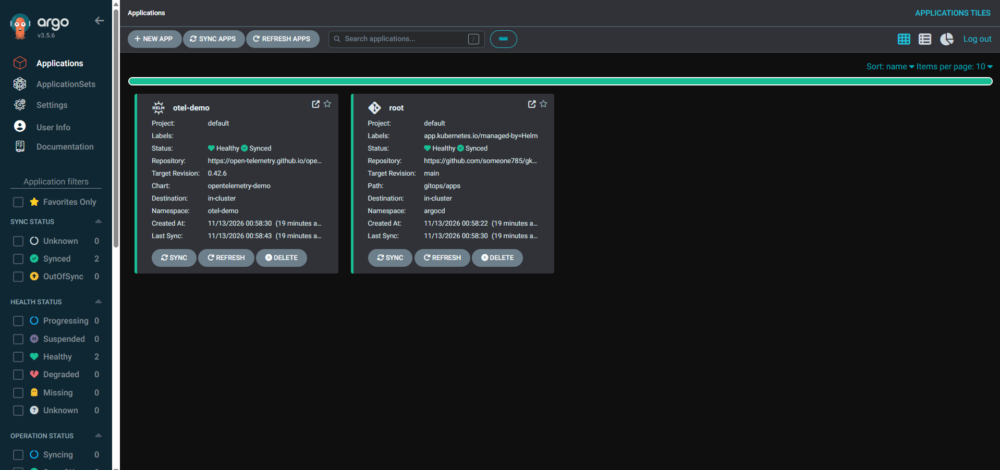
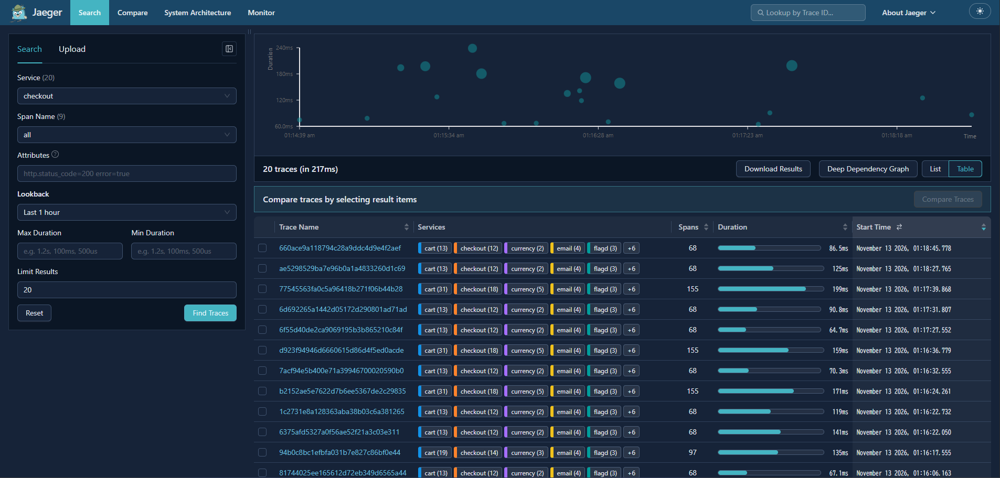
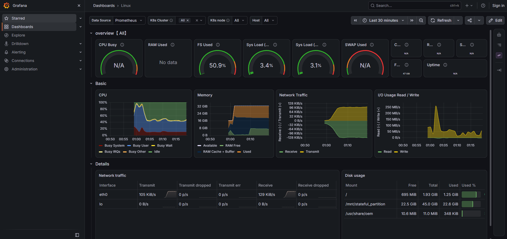

# フェーズ 1 のデモの記録

README の「再現の手順」どおりに、`terraform apply` から OTel Demo の画面が開くまでを通しで動かした記録。
クレジットの期限 (2027-01-27) の後はクラスタを動かせないため、動いていたことをここに残す。

- 実施日: 2026-11-13
- コミット: d235b6f
- 所要時間: 約 1 時間 (正確な時刻は記録していない)

<!-- 【スクリーンショットに秘密を写さない】ArgoCD のパスワード、トークン、kubeconfig の中身。プロジェクト ID も写らないようにする -->

## 1. クラスタを作る (手順 3)
- `terraform plan`: `Plan: 13 to add, 0 to change, 0 to destroy.` (想定どおり)
- `terraform apply`: `Apply complete! Resources: 13 added, 0 changed, 0 destroyed.` クラスタの作成 5 分 27 秒、ノードプール 1 分 2 秒
- `kubectl get nodes` (`get-credentials` の後):
  ```
  NAME                                     STATUS   ROLES    AGE    VERSION
  gke-gke-golden-path-spot-8da59834-r6jp   Ready    <none>   7m6s   v1.36.4-gke.2377000
  ```
  ノードの版は 11/8・11/11 の 1.36.4-gke.2046003 から上がっていた (REGULAR チャンネルの更新)

## 2. ArgoCD と OTel Demo を入れる (手順 4)
- `terraform plan`: `Plan: 2 to add, 0 to change, 0 to destroy.` (想定どおり)
- `terraform apply`: `Apply complete! Resources: 2 added`。ArgoCD 54 秒、ルートの Application 2 秒
- Synced / Healthy: 前回 (11/11) と違い、手で同期を指示しなくても一度で Synced / Healthy になった (`ServerSideApply=true` の効果)。Pod は 30 個すべて Running、再起動 0 (Pod の作成から 17 分の時点)
- `kubectl get applications -n argocd`:
  ```
  NAME        SYNC STATUS   HEALTH STATUS
  otel-demo   Synced        Healthy
  root        Synced        Healthy
  ```



## 3. 画面を開く (手順 5)






- Grafana で、ノードの `/mnt/stateful_partition` (イメージの置き場) は 45.0 GiB 中 22.6 GiB 使用 (約 50%)。11/11 (ディスク 30 GB) の約 83% から下がった

## 4. CI がクラスタのある状態でも plan できるか
- `workflow_dispatch` で手動実行した run 43253155788: 成功。`No changes. Your infrastructure matches the configuration.` → クラスタがある状態でも、CI の権限 (viewer、serviceUsageConsumer、state バケットの objectUser) で plan できる
- ArgoCD: README のコマンドで表示した初期パスワードで、`admin` としてログインできた

## 5. 消す (手順 6)
- platform の destroy: `Apply complete! Resources: 0 added, 0 changed, 2 destroyed.`
- 本体の destroy: `Apply complete! Resources: 0 added, 0 changed, 13 destroyed.` クラスタの削除 5 分 3 秒、ノードプール 3 分 22 秒
- 残っているもの: `gcloud` の一覧で `Listed 0 items.` を確認した (3 つのコマンドのうち 2 つ分の出力。残りの 1 つは出力がなかった)
- リポジトリを private に戻した: `{"visibility":"PRIVATE"}`

## README の手順との差分
- 手順 3〜6 は、README のとおりに動いた。手で同期を指示する必要もなかった
- 手順 2 の後半 (backend.hcl などのコピーと init) は、作業用の端末で済んでいたため今回は試していない
