# フェーズ 2 のデモの記録

障害を起こしてから、アラートで気付き、トレースで原因を特定し、直すまでの記録。
段取りは [phase2-script.md](phase2-script.md)、対応の手順は [Runbook](../runbooks/checkout-place-order.md)、振り返りは [ポストモーテム](../postmortems/2026-11-17-payment-failure.md)。

- 実施日: 2026-11-17 (JST)
- 障害: OTel Demo の flagd で `paymentFailure` を `50%` にする (payment の Charge が半分の確率で失敗する)
- SLO: checkout の注文 (`oteldemo.CheckoutService/PlaceOrder`) の成功率 99% ([ADR 0006](../adr/0006-slo-and-alerting.md))

<!-- 【スクリーンショットに秘密を写さない】Jaeger の span の詳細の Resource の行には cloud.account.id (プロジェクト ID) が出る。09 はその行を塗りつぶした -->

## 時系列 (JST)
| 時刻 | 出来事 | 根拠 |
|---|---|---|
| 00:51:49 | 平常 (アラートは inactive) | 操作した人の記録 |
| 00:56:09 | 障害による最初のエラー (flagd を保存したのは、この少し前) | Jaeger |
| 00:58:29 | **ticket のアラートが鳴った** (+2 分 20 秒) | Prometheus の `activeAt` |
| 01:02:29 | **page のアラートが鳴った** (+6 分 20 秒) | Prometheus の `activeAt` |
| 01:03 〜 01:06 | メトリクスで payment に絞り込み、Jaeger で発生源 (payment の `charge`、`Invalid token`) を特定した | 操作の記録 |
| 01:12:29 | 最後のエラー (この直後に flagd を `off` に戻した) | Jaeger |
| 01:17:30 | **回復**: 5 分の窓のエラー率が 0 に (障害中の最大は 69%) | Prometheus |
| 01:37:48 | **page のアラートが解消** (ticket は 01:53 の時点でも鳴っていた。解消を待たずに destroy した) | Alertmanager |

| 指標 | 値 |
|---|---|
| 検知までの時間 (最初のエラー → 最初のアラート) | 約 2 分 20 秒 (ticket)。page は約 6 分 20 秒 |
| 特定までの時間 (最初のアラート → 原因の特定) | 約 7 分 (画面を撮りながら) |
| 回復までの時間 (最後のエラー → 5 分の窓が 0) | 約 5 分 |
| アラートの解消までの時間 (対処 → 解消) | page は約 25 分。ticket は 40 分以上 (計測せず) |

## 1. 平常
SLO のアラートは、page も ticket も `inactive`。

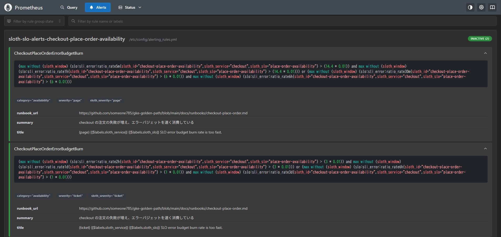

## 2. 障害を入れる
flagd で `paymentFailure` を `50%` にした。

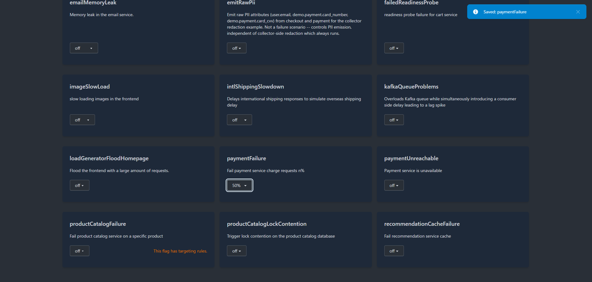

## 3. 症状
Shop で注文すると、半分ほどが失敗する。【失敗しても、画面には何も表示されない】注文のボタンを押しても画面が変わらないだけで、エラーはブラウザのコンソールにしか出ない (`api/checkout` が 422、`Your payment could not be processed.`)。

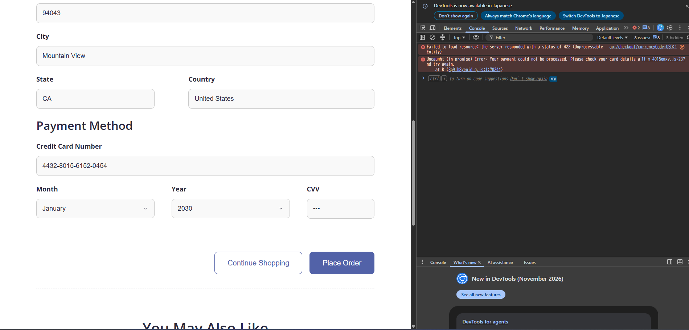

## 4. 検知
先に **ticket** (遅い燃え方) が鳴り、約 4 分後に **page** (速い燃え方) が鳴った。

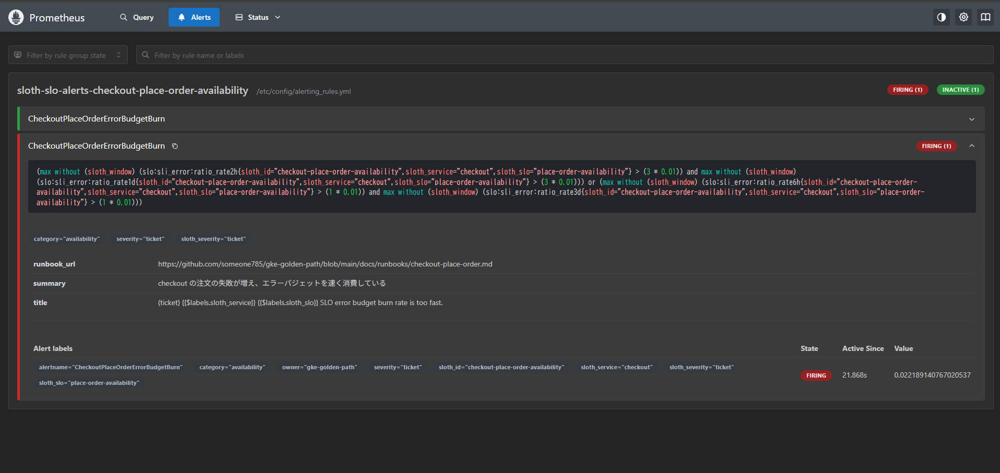

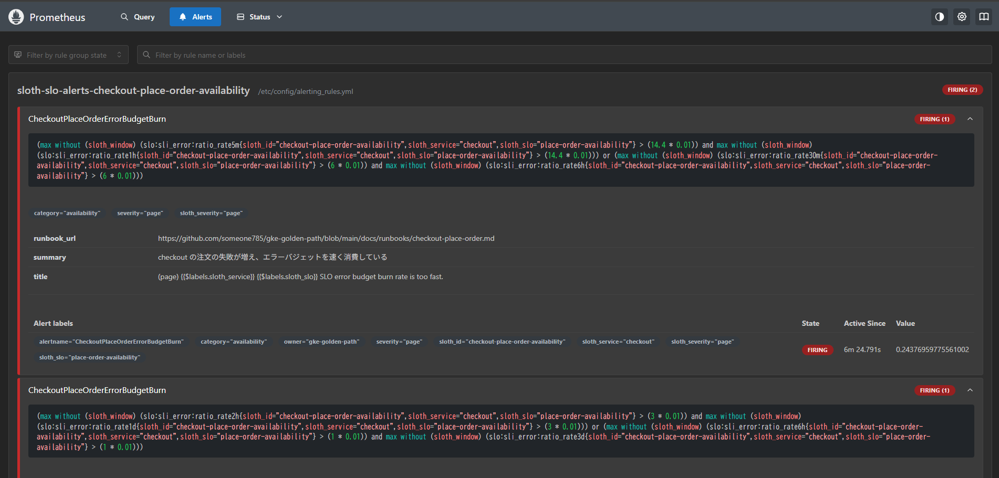

Alertmanager にも届いた。アラートには、日本語の要約と Runbook の URL が付いている。

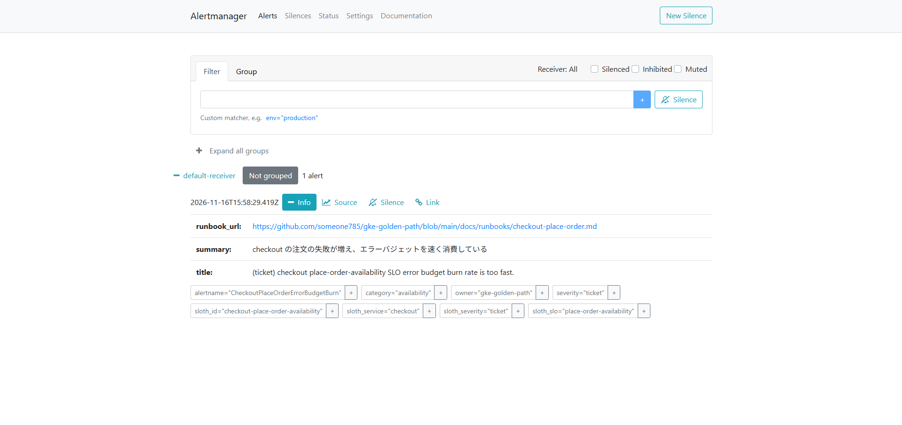

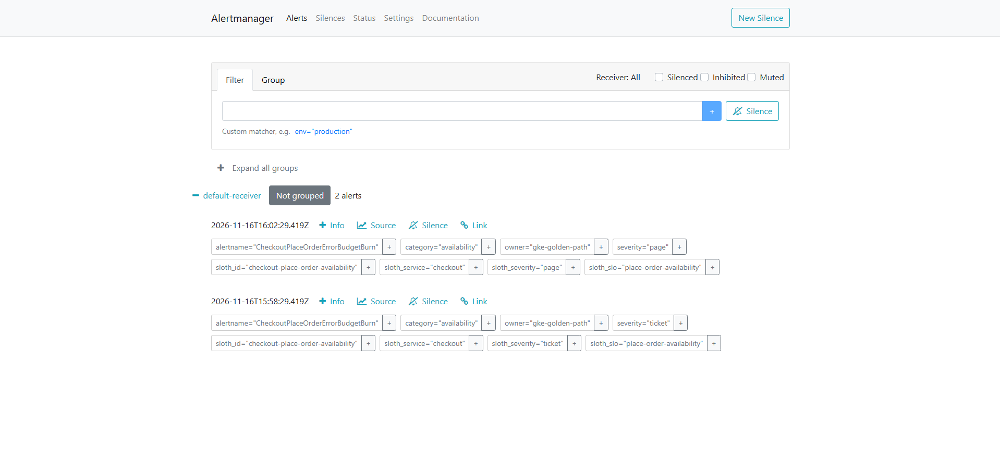

## 5. 絞り込み (メトリクス)
Runbook の手順 3 の式で、エラーを出している span をサービスごとに並べた。checkout と frontend (と、その手前の frontend-proxy) のほかに、**payment** がエラーを出している。
上の 7 行は同じ値。1 回の失敗した注文が、呼び出しの経路にあるすべての span にエラーとして残るため。**メトリクスだけでは、どれが発生源かは分からない**。

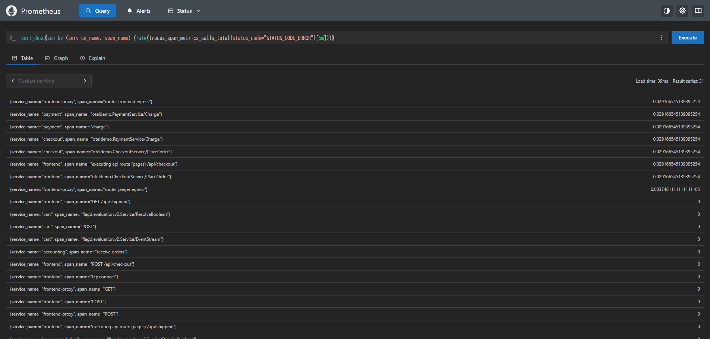

## 6. 特定 (トレース)
Jaeger で payment を通るトレースを検索した。エラーあり (赤い 7) となし (-) が半々に混ざっている (50% の失敗)。

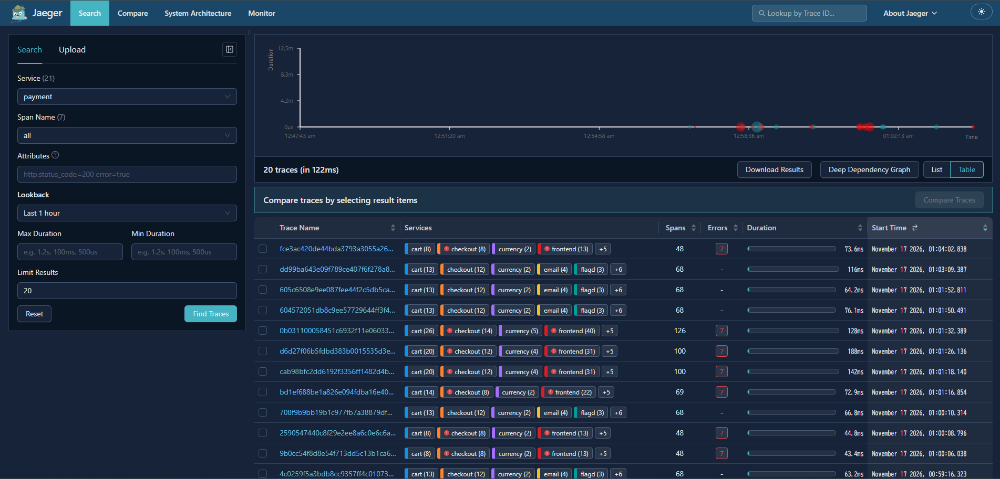

失敗したトレースを開き、赤い印を呼び出し先へたどった。frontend の `POST /api/checkout` (422) から、checkout の `PlaceOrder`、checkout から payment への `Charge` を経て、**payment の `charge` が一番深い**。cart、product-catalog、currency、shipping、quote は正常 (200)。

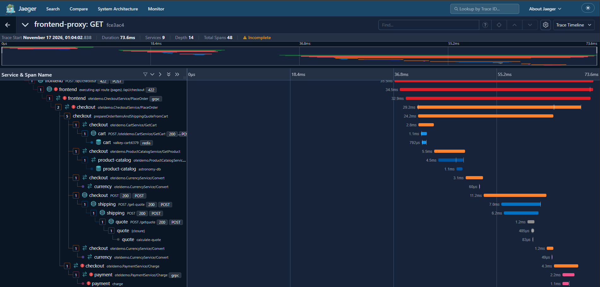

`charge` の span の例外: `Payment request failed. Invalid token. demo.user_context.loyalty_level=gold` (`charge.js:48`)。

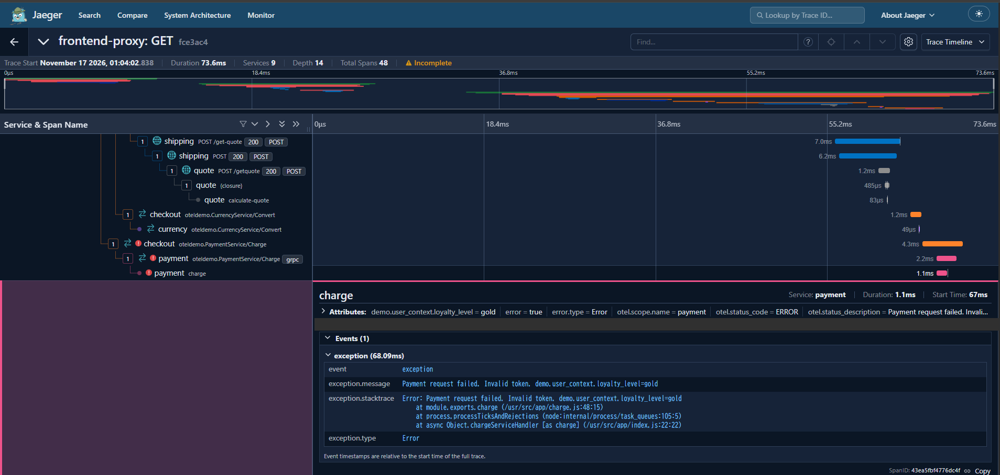

## 7. 対処
Runbook の手順 4 のとおり、flagd で `paymentFailure` を `off` に戻した。

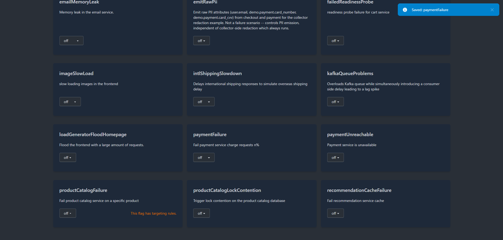

## 8. 回復
最後のエラーから約 5 分で、5 分の窓のエラー率が 0 になった。

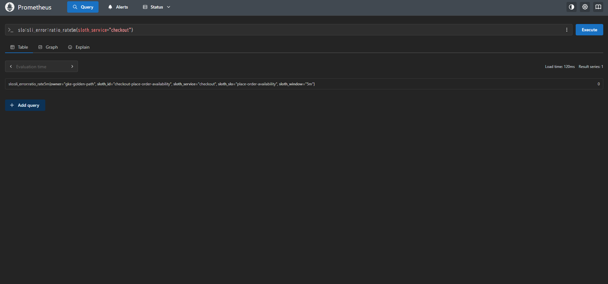

## 9. 直ってもアラートは鳴り続ける
窓ごとの値は、5 分 0%、30 分 28%、1 時間 15%、6 時間 10%。page の「30 分と 6 時間の窓で 6% 超」の条件が残るため、アラートは鳴り続ける。Runbook の手順 5 のとおり、**5 分の窓が 0 なら対応は終わり**。

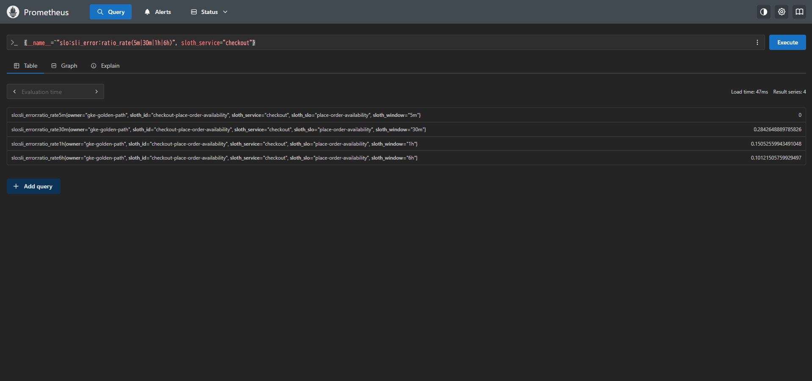

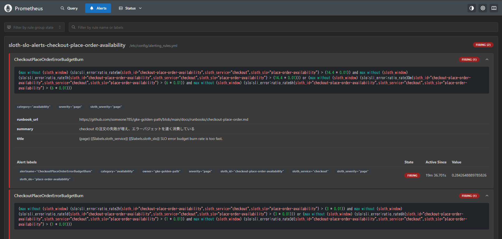

## 通し稽古 (2026-11-14) との違い
| | 通し稽古 | 本番 |
|---|---|---|
| 障害を入れるまでの平常の時間 | 短い | 10 分以上 |
| 最初に鳴ったアラート | page (約 1.5 分) | ticket (約 2 分 20 秒)。page は約 6 分 20 秒 |

1 時間の窓に平常の時間が長く含まれるほど、page の「5 分と 1 時間の窓で 14.4% 超」は成り立ちにくくなる。注文は 1 分あたり約 2.7 件と少なく、窓の値が上がるのに時間がかかった。
